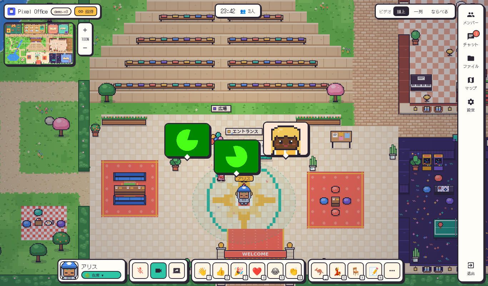
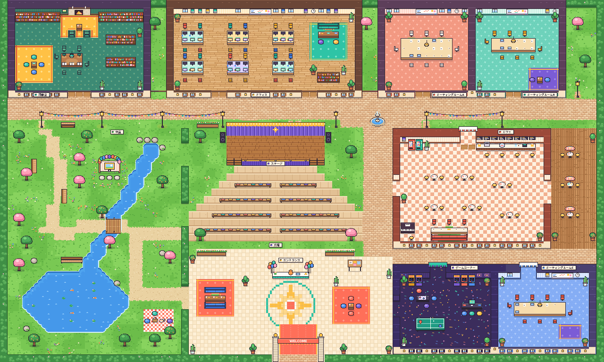
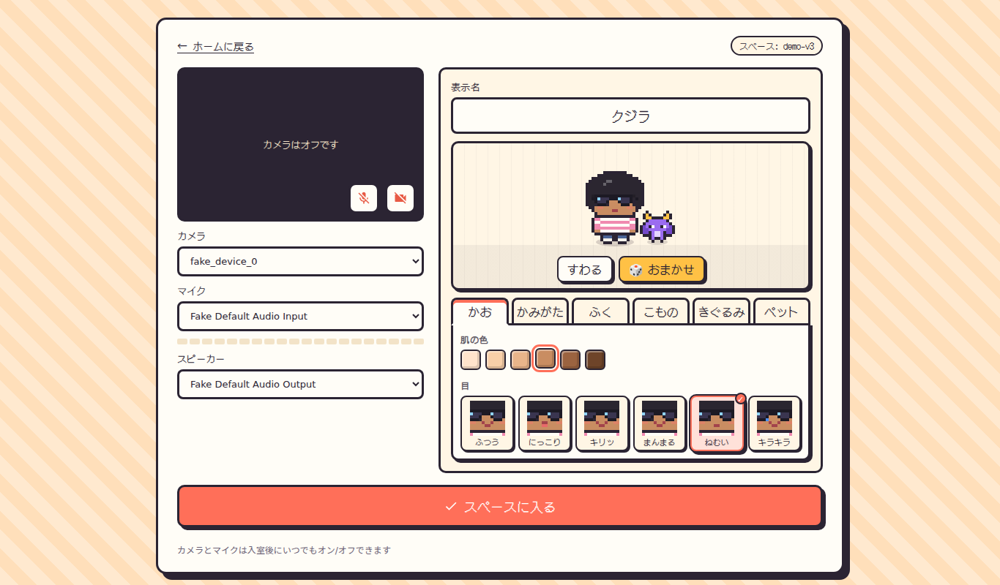
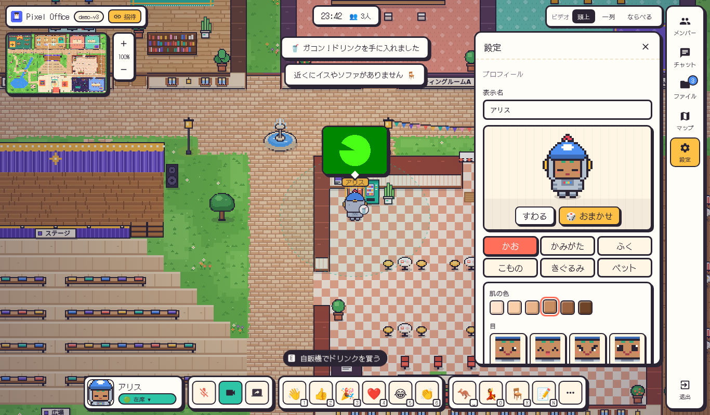
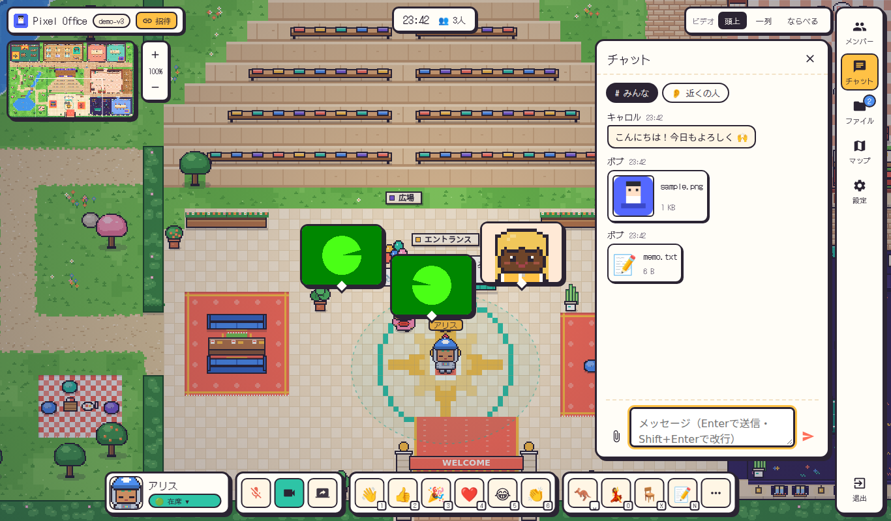
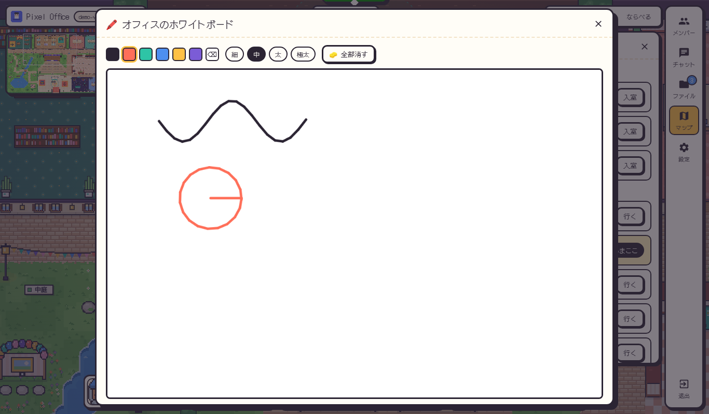
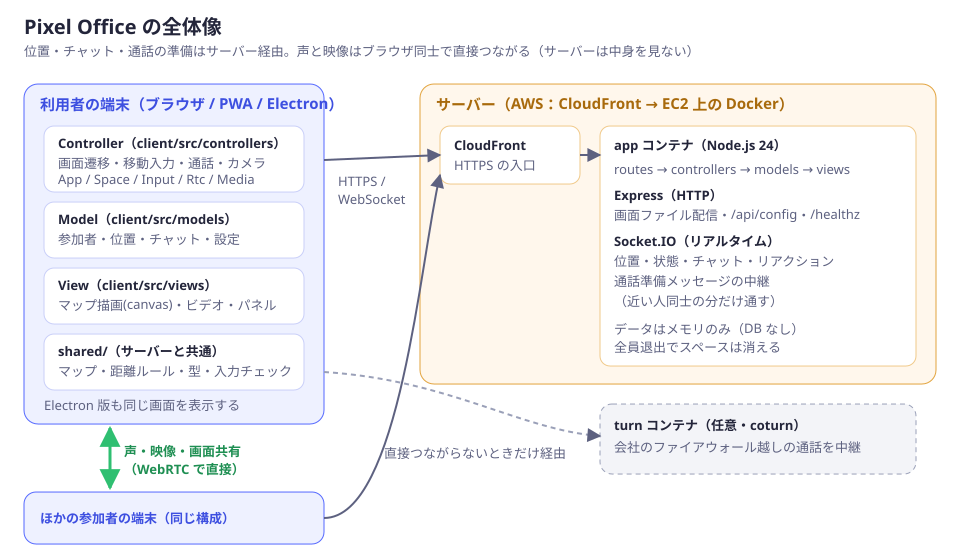

# Pixel Office

ドット絵の街を歩き回る**2D バーチャルオフィス**です。近くにいる人とだけ声と映像がつながります。ファイル共有、ホワイトボード、付箋、着ぐるみやペット付きのアバターなど、遊びの要素もたくさん入れました。ログインはなく、リンクを共有すれば招待できます。



## マップ

キャンパス風の街です（80×48マス）。大通りと噴水広場を中心に、次の 11 エリアがあります。



| エリア | 特徴 |
|---|---|
| エントランス | 最初に現れる場所 |
| オフィス | 机とイス。ホワイトボードがある |
| ミーティングルーム A / B / C | 🔒 中にいる人とだけ話せる。それぞれにホワイトボードがある |
| 図書室 | 🤫 声は出せない（チャットのみ）。集中したい人向け |
| ステージ ＋ 広場 | 🎤 ステージに立つと、広場にいる全員に声が届く |
| カフェ | 自販機、テーブル、テラス |
| 中庭 | 小川と池、桜、記念撮影スポット |
| ゲームコーナー | アーケード機と卓球台 |

## できること

### 話す・集まる
- **近づいて話す**：約 4.5 マス以内の人と、声と映像が自動でつながります。距離に応じて声が小さくなります。
- **ビデオの表示**：「頭上」（アバターの頭の上に吹き出しのように浮かぶ）、「一列」、「ならべる」から選べます。画面共有は右上に出て、クリックすると大きく表示されます。
- **ステータス**：🟢在席・🗣️会議中・🎧集中・🍙ランチ・☕休憩・💤離席の 6 種類と、ひとことコメント（例：「13時に戻ります」）。集中中は近くを通っても自動ではつながりません（会議室では話せます）。
- **メガホン**：フロア全員に声を届けます。**インターホン**：相手を呼び出してチャイムを鳴らします。
- **ついていく**：人をクリックして「ついていく」を選ぶと、その人の後を歩きます。

### 動く・遊ぶ
- **移動**：矢印キー / WASD で歩く。クリックした場所へは壁をよけて歩く（経路探索）。ダブルクリックで瞬間移動。ミニマップのクリックでも移動できます。
- **エモート**：数字キー `1`〜`6` で 👋👍🎉❤️😂👏 のリアクション。🎉 は紙吹雪、🔥 は火花が出ます。`7` で手をふる、`8` でくるっと回る、`Space` でジャンプ、`0` でダンス。
- **座る**：イス・ソファ・ベンチの近くで `X` を押すと座ります。
- **使う（`E`）**：
  - ホワイトボード：近くにいる人と同時にお絵描きできます。
  - 自販機：ランダムにドリンクが出て、手に持ちます。
  - 撮影スポット：3・2・1 のカウントダウンで記念写真を保存します。
- **チャット**：「#みんな」と「👂近くの人」の 2 種類。発言はアバターの上に吹き出しでも出ます。`/dice`（サイコロ）、`/omikuji`（おみくじ）、`/janken グー`（じゃんけん）、`/coin`（コイン投げ）が使えます。結果はサーバーが決めるので、ごまかせません。
- **演出**：天気（🌸桜・❄️雪・☔雨・🍁紅葉）と、時刻に合わせた昼・夕方・夜の明るさ。

### 共有する
- **ファイル共有**：チャットに添付（📎ボタン、ドラッグ＆ドロップ、貼り付け）するか、マップの足もとに置けます。画像はサムネイルで表示されます。1 ファイル 20MB まで、スペースごとに 200MB / 100 個まで。共有したものはスペースに保存され、次に来たときも残っています。
- **付箋**：`N` で足もとに付箋を貼れます。マウスを乗せると内容が見えます。
- **ファイル一覧**：スペースで共有されたファイルがすべて並びます。置いてある場所へ歩いて行けます。

### アバター
着ぐるみやペットを含め、組み合わせは約22億通りです。

| 部位 | 種類 |
|---|---|
| 肌 | 6 色 |
| 髪 | 12 色 × 12 種類 |
| 目 | 6 種類 |
| 服 | 12 種類 × 10 色 |
| 小物 | 19 種類（メガネ、ネコ耳、魔女の帽子、天使の輪など） |
| 着ぐるみ | 14 種類（ネコ、パンダ、サメ、ドラゴン、ユニコーンなど） |
| ペット | 11 種類（後ろをついて歩く） |

絵はすべてコードで描いているので、画像の著作権を気にする必要がありません。

| 入室前のロビー（アバターを作る） | アバターの着せかえ（設定から） |
|---|---|
|  |  |
| **チャットとファイル** | **ホワイトボード** |
|  |  |

### キー操作
| キー | 動作 |
|---|---|
| 矢印 / WASD | 歩く |
| クリック / ダブルクリック | その場所へ歩く / 瞬間移動 |
| `1`〜`6` | リアクション |
| `7` / `8` / `Space` / `0` | 手をふる / 回る / ジャンプ / ダンス |
| `X` / `E` / `N` / `H` / `M` | 座る / 使う / 付箋 / 挙手 / マイク |
| `Enter` / `P` / `F` / `G` / `,` | チャット / メンバー / ファイル / マップ / 設定 |
| `Esc` | パネルを閉じる・ついていくのをやめる |

## 動かし方

### A. Docker（AWS と同じ形）
```bash
docker compose up --build        # → http://localhost:3000
```
データベースとアップロードされたファイルは、Docker ボリューム `pixel-data` に保存されます。AWS への出し方は [docs/DEPLOY_AWS.md](docs/DEPLOY_AWS.md) を見てください。

### B. Node.js で直接（開発用、Node.js 24 以上）
```bash
npm ci
npm run dev        # 開発サーバー（保存すると画面が自動更新）→ http://localhost:3000
npm test           # 自動テスト（37 件）
npm run typecheck
npm run build && npm start   # 本番モード
```
ブラウザがカメラとマイクを使わせてくれるのは、**https か localhost のときだけ**です。

### C. デスクトップアプリ（Electron）
```bash
cd desktop
npm run setup      # 初回だけ
npm start          # 接続先 http://localhost:3000（環境変数 PIXEL_OFFICE_URL で変更）
npm run dist:win   # Windows 用インストーラー（Windows 上で実行）
```

### D. PWA
本番モードで開くと「アプリとしてインストール」できます（Chrome / Edge）。

## しくみ



- **サーバーを通るもの**：位置、チャット、付箋、ホワイトボード、通話の準備。Socket.IO（WebSocket）を使います。
- **ファイル**：HTTP でアップロード・ダウンロードし、サーバーのディスク（Docker ボリューム）に置きます。
- **声と映像**：WebRTC でブラウザ同士が直接つながり、サーバーは中身を見ません。直接つながらないときは TURN（coturn）が中継します。
- **保存**：スペースは消えません。チャット（#みんな）・付箋・ホワイトボード・ファイルは、Node.js 内蔵の SQLite（`data/pixel-office.db`）とファイル置き場に保存されます。全員が退出しても、サーバーを再起動しても残ります。
  - 保存しないもの：位置、ステータス、「近くの人」チャット。
  - 自分の付箋やファイルは、次に来たときも自分のものとして消せます。ブラウザごとに作るランダムな鍵で本人を見分けるためです。
  - 古いスペースを自動で消したい場合は、`SPACE_RETENTION_DAYS`（例：90 日使われなければ削除）で設定できます。初期値は 0（消さない）です。
  - 誰でもスペースを作れるので、ディスクを守るための上限を設けています。保存できるスペース数（`MAX_STORED_SPACES`、初期値 1000）と、サーバー全体のファイル容量（`MAX_TOTAL_STORAGE_MB`、初期値 10GB）です。

### MVC の分け方
| 層 | サーバー（`server/`） | 画面側（`client/src/`） |
|---|---|---|
| **Model**：データとルール | `models/Space.ts`（チャット・ファイル・付箋・ボード・チャットコマンド）、`Player.ts`（入力チェック・本人の見分け）、`SpaceStore.ts`（読み込み・上限・保持期間）、`SpaceRepository.ts`（SQLite への保存） | `models/SpaceModel.ts`、`SettingsModel.ts` |
| **View**：見せ方 | `views/spaceView.ts`（送信データの形を決める） | `views/MapView.ts`（マップ・アバター・吹き出し）、`effects.ts`（紙吹雪・天気）、`VideoView.ts`、`ShellView.ts`（画面の枠）、`MinimapView.ts`、`WhiteboardView.ts`、`panels/*`、`avatarSprite.ts`、`petSprite.ts`、`tileArt.ts` |
| **Controller**：受け取って動かす | `controllers/SpaceSocketController.ts`、`FileController.ts`、`ApiController.ts`、`routes/*` | `controllers/SpaceController.ts`（司令塔）、`InputController.ts`（移動・キー）、`RtcController.ts`（通話）、`MediaController.ts`（カメラ）、`AppController.ts`（画面遷移） |
| 共通 | `shared/`：マップ、距離のルール、経路探索、型、アバターの選択肢、入力チェック | |

### 技術の選び方と理由
| 使ったもの | 理由 |
|---|---|
| TypeScript（Node.js 24 で直接実行） | サーバーと画面で型とルールを共有できる。サーバー側のビルド工程も要らない |
| Express 5 + Socket.IO 4 | 保守が活発で利用者が多い。ファイルの受け取りは `express.raw` で済むので、追加ライブラリが要らない |
| WebRTC（ブラウザ標準） | 少人数なら P2P で十分で、サーバー費用もかからない |
| Canvas 2D（ゲームエンジンなし） | 依存を減らせば、脆弱性を抱える範囲も減る |
| DotGothic16（ドット文字フォント、OFL） | 自分のサーバーから配信するので、外部への通信がない |
| Electron 44 | Discord と同じ方式のデスクトップアプリにできる |

## セキュリティ
詳しくは [docs/SECURITY.md](docs/SECURITY.md) にあります。要点は次のとおりです。

- **依存パッケージ**：`npm audit` で 0 件です。
- **通話**：サーバー側でも距離をチェックし、遠くの人からの通話開始は中継しません。
- **ファイル**：入室中の人だけがアップロード・ダウンロードできます（入室時に配る合言葉で確認）。
  - 画像かどうかは中身の先頭バイトで判定します。PNG / JPEG / GIF / WebP 以外（SVG も含む）は必ず「ダウンロード」扱いにして、ブラウザでは開きません。
  - 配信するファイルには `sandbox` 付きの CSP を付けるので、中のスクリプトは動きません。
- **入力**：すべてサーバーで検証し、種類ごとにレート制限をかけています。チャットや名前は `textContent` でしか表示しないので、HTML を仕込まれても実行されません。
- **Docker**：root 以外のユーザーで動かし、ファイルシステムは読み取り専用、書き込めるのはデータ用のボリュームだけです。
- **Electron**：sandbox を有効にし、Fuses で危険な機能を無効化しています。

## 制限と今後
- **人数**：全員が直接つながるので、同じ場所で同時に話すのは 5〜8 人までが快適です。スペースの上限は 25 人です。大人数にするなら LiveKit（SFU）に切り替えます。
- **ログインなし**：リンクを知っている人は入れます。社内で使うなら、CloudFront の前に認証を置いてください。
- **サーバー 1 台が前提**：複数台にするなら、データは RDS などの共有データベース、ファイルは S3 に移します。
- **バックアップ**：データはボリューム `pixel-data` の中だけにあります。消えると困るので、定期的にバックアップしてください（手順は [docs/DEPLOY_AWS.md](docs/DEPLOY_AWS.md) にあります）。
